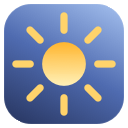

# AutoBrightness



A small native macOS menu bar app for the built-in display's **Automatically adjust brightness** setting (System Settings → Displays).

## Use

Open **AutoBrightness.app**. A sun appears in the menu bar:

- **Left-click:** turn automatic brightness on or off immediately.
- **Filled sun:** on. **Outline sun:** off. A faded outline means the setting can't be read or isn't available.
- **Right-click** (or Control-click, or the VoiceOver "Show options" action): a frosted panel opens under the icon with the **Automatic brightness** switch, a short explanation, **Displays Settings…** and **Quit**. Click outside, press Escape, or click the icon again to dismiss it. Space or Return operates the focused control, Tab moves between them.
- If a left-click can't change the setting, or the Mac has no ambient light sensor, the panel opens and says why. On an unsupported Mac there is no switch, only a button that opens Displays settings.

Every change is confirmed by reading the setting back from macOS before the icon or switch moves, and a second change is ignored while one is in flight. macOS does the ambient light sensing itself; the app does nothing in the background. It asks for no Accessibility, Screen Recording or administrator permission, makes no network requests, and has no login item or helper. It controls only this one setting for the built-in display — no keyboard backlight, True Tone, Night Shift, external displays, schedules, thresholds or brightness slider.

The icon reflects the setting as of launch, the last panel open, or the last click. There is no polling, so a change made in System Settings shows up on the next click or panel open (a click always flips the real current value).

## Build and run

Needs Apple silicon, macOS 26.4 or newer and Apple's command-line developer tools. Built and verified on a MacBook Air (Mac17,4, Apple M5) running macOS 27.0.1.

```sh
./build.sh      # builds and ad-hoc signs AutoBrightness.app (icon is generated from drawing code)
./test.sh       # backend + UI checks against a fake backend; never touches the real setting
open AutoBrightness.app
```

Diagnostics on the built executable:

```sh
./AutoBrightness.app/Contents/MacOS/AutoBrightness --diagnose   # print the setting; changes nothing
./AutoBrightness.app/Contents/MacOS/AutoBrightness --profile    # open the panel, reopen it five times; read-only
./AutoBrightness.app/Contents/MacOS/AutoBrightness --verify     # LIVE: really toggles the setting, then restores it
```

`--verify` identifies itself, is never run by `build.sh` or `test.sh`, snapshots the original value, and restores and re-reads it on normal completion, Quit, SIGINT, SIGTERM and SIGHUP (a `kill -9` cannot be intercepted). Measure through LaunchServices with
`open -n -W -a AutoBrightness.app --stdout out.txt --args --verify`.
CPU of an idle normal instance: `xcrun clang -Os research/cpu-measure.c -o /tmp/cpu && /tmp/cpu PID 20`.

## Private API risk

Apple documents the setting only as a checkbox; there is no public API. The app calls three private functions from `DisplayServices.framework` (`DisplayServicesHasAmbientLightCompensation`, `…AmbientLightCompensationEnabled`, `…EnableAmbientLightCompensation`), loaded with `dlopen`/`dlsym`. Their arm64 signatures were read from the disassembly, not guessed — see `research/Backend.md`. The app refuses to run (unsupported state) if the framework or a symbol is missing, no built-in display or ambient light sensor exists, the getter fails or returns a non-boolean/unwritten byte, or a write isn't confirmed by readback. A future macOS update can still remove or change these functions, and one that keeps the signatures but changes their meaning could not be detected. The panel's blur likewise uses a private SkyLight call, with a native `NSVisualEffectView` fallback. It can't be distributed through the Mac App Store.

## Resource use

**The 8.00 MB footprint target is not met.** Measured through LaunchServices on this Mac: a plain launch (menu bar icon only, setting read) idles at **7.849 MB** with a lifetime peak of **8.144 MB**. After the full `--verify` interaction (panel opened and reopened, keyboard, accessibility and menu-bar-click toggles in both directions) the footprint is **9.209 MB** and the lifetime peak **10.175 MB** (three runs: 10.126–10.241 MB). On this OS an empty accessory app with one `NSStatusItem` already measures 8.08 MB footprint / 8.42 MB peak with the best allocator settings, so a status-item app cannot get under 8 MB here. `research/Memory.md` has the evidence and the allocator A/B; `Verification.log` has the numbers.

Idle CPU over 20 s after the panel closed: 0.003% of one core (0.6 ms total), one idle wakeup, none periodic. No timers, no polling.

## Files

`src/auto.h` backend (load, read, write with readback) · `src/main.m` app, status item, panel, verification modes · `src/tests.m`, `src/ui-tests.m`, `src/fake.h` checks · `research/` backend and memory notes, probes · `artwork/draw-icon.m` icon · `graphify-out/` code graph (code only; docs not extracted).
